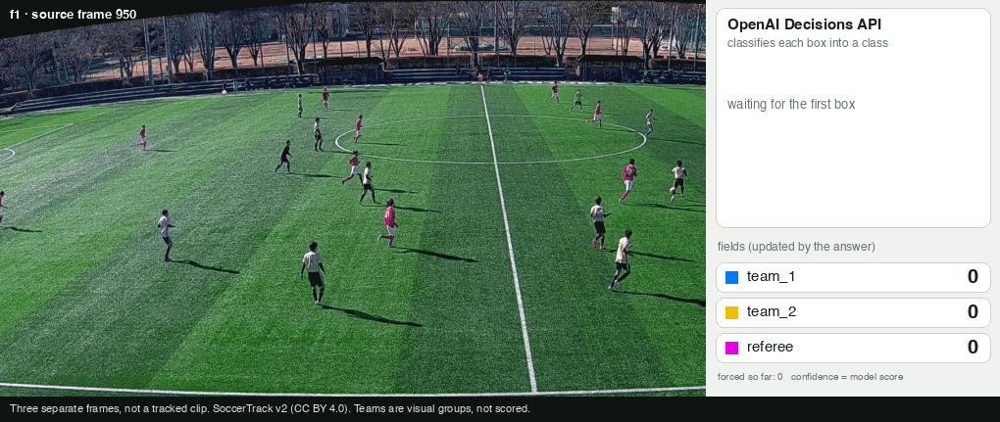
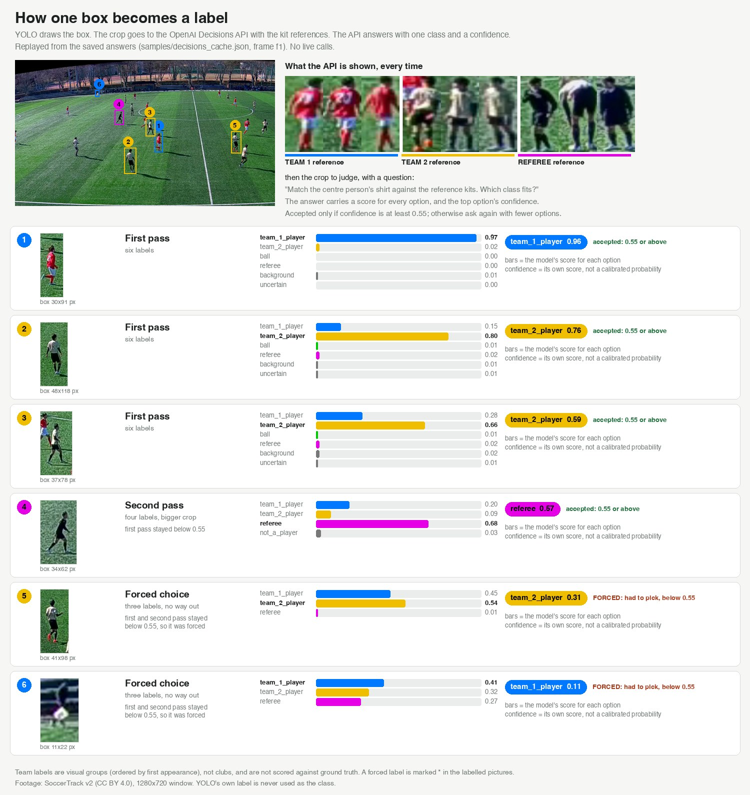
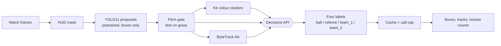

# Zero-shot football vision

Label players in a football frame as **referee / team_1_player / team_2_player** (and look for the **ball**) with no training and no hand labels.

A public YOLO model proposes regions. ByteTrack follows them. The OpenAI **Decisions API** judges each region.



*The three labelled sample frames (SoccerTrack v2, 1280x720 windows). Each box is cropped, sent to the Decisions API, and the answer updates a field. Blue = team_1, yellow = team_2, pink = referee. Counts come from the saved csv files; three separate frames, not a tracked clip. Rows with `forced=True` in the csv are guesses; team labels are visual groups and are not scored. See [Results](#results).*

## How a box becomes a label

Each YOLO box is cropped and sent to the Decisions API with the three kit references. The API answers with one class and a confidence, and a score for every option. Below 0.55 it is asked again with fewer options, and if it still stays below, it is forced to pick (`forced=True`). Confidence is the model's own score, not a calibrated probability.



*Frame f1, replayed from the saved answers (no live calls). The same walk-through step by step: [`how_decisions_works.gif`](docs/img/how_decisions_works.gif).*

## Architecture



**In short:** YOLO and ByteTrack only say *where* something is and *which box is the same object over time*. They never decide a class. Decisions looks at crops, with kit references for context, and answers with one of four labels. Everything it says goes through a cache and a call cap, so runs are repeatable and cost is bounded.

## The problem

The usual route to "find the players, split the teams, spot the referee and the ball" is to train a detector:

1. collect footage, 2. draw boxes and class labels by hand, 3. train or fine-tune, 4. check, fix labels, repeat.

The labeling is the slow part, and it repeats whenever kits, camera or footage change. A model trained on one match's kits does not know the next match's.

## The approach

| Stage | Tool | Trained on our data? |
|---|---|---|
| Propose regions (people, maybe a ball) | public YOLO11 (COCO weights) | No |
| Follow regions over time | ByteTrack (inside ultralytics) | No |
| Decide what each region is | OpenAI Decisions API | No |

YOLO's own labels are metadata only. They never become a class. Decisions is the classifier, and it must answer with one of the four labels. When it could not settle, the row carries `forced=True`.

**What it costs instead of labeling time:** API calls. Every call is cached, counted and capped (see [Cost](#cost)). The shipped cache holds 1,012 saved answers from several earlier runs on the sample frames. They do not replay on a fresh run (see [Cost](#cost)). The Decisions model is `gpt-6-luna` (`DECISIONS_MODEL` in `src/config_io.py`). We have not measured the spend of those runs. We have not measured the labeling time or cost of a trained detector, so this repo makes no claim about how they compare in dollars or hours.

## Install

Python 3.12 recommended.

```bash
git clone <this repo> && cd zero-shot-football-vision
python3 -m venv .venv && source .venv/bin/activate
pip install -r requirements.txt
```

YOLO weights (`yolo11s.pt`) download on first run.

## Footage

The samples are cut from **SoccerTrack v2** (clip 118577), a fixed-camera panorama of a full match, licensed **CC BY 4.0**. Credit: the SoccerTrack v2 authors (see [Citation](#citation)). The data is gated on Hugging Face (`atomscott/soccertrack-v2`), so request access there; this repo ships only the three 1280x720 windows and one 3 s clip cut from it, not the dataset.

Each frame is a window cut from the top of the 4096x1080 panorama at native resolution (no resize). Source frames 950, 1250, 3400. The 3 s clip is source frames 3363-3437 at a different window (x=1760).

The camera is fixed, so the scoreboard/minimap (HUD) step is switched off here (`HUD_MODE = "none"`; auto-detection finds a false HUD on static edges). YOLO runs at `imgsz=1280`, because players are only 30-70 px tall.

## Run on the sample frames

```bash
jupyter lab notebooks/zero_shot_football_vision.ipynb
```

Pick the Jupyter kernel that uses Python 3.12 (an older default `python3` kernel may fail on f-strings). Run all cells. The default dry run executes without any key, but it does **not** reproduce the published labels: the saved answers in `samples/decisions_cache.json` mostly miss on a fresh run, because cache keys include the kit images, which depend on the frame set. A trial run of the 3 shipped frames gave 149 lookups, 0 cache hits, 70 `uncertain` boxes and 0 team labels. To reproduce the labels you need your own key: set `OPENAI_API_KEY`, set `LIVE_CALLS = True` and raise `MAX_CALLS` to about 200 (the notebook projects about 150 calls for the 3 frames; check its dry-run projection first). The saved results are in `docs/img/` (images) and `samples/results/` (CSVs). The clip-level live vote is off by default (`LIVE_CLIP_CALLS = False`), and the ball window search was not run for the shipped cache, so those two steps are dry runs.

## Cost

A live run costs API calls, on the sample frames and on your own images.

Every Decisions answer is saved in a cache file. The same question later is answered from that file: no call, no cost.

- **Sample frames:** the shipped cache (1,012 answers from earlier live runs) mostly misses on a fresh run, because cache keys include the kit images, which depend on the frame set. With `LIVE_CALLS = False` the misses are skipped and boxes come out `uncertain`. To reproduce the published labels, set `OPENAI_API_KEY`, `LIVE_CALLS = True` and `MAX_CALLS` to about 200 (about 150 calls projected).
- **Your own images:** new crops, so new calls. Put PNGs named `frame_01_src950.png`, `frame_02_src1250.png`, ... in `samples/frames/`. Run with `LIVE_CALLS = False` first to count the calls. Then copy `.env.sample` to `.env`, add `OPENAI_API_KEY`, and set `LIVE_CALLS = True`.
- **Hard cap:** `MAX_CALLS` (default 70; raise it for a full 3-frame run, which needs a few hundred calls on new frames). The run stops at the cap.
- **Re-runs:** new answers are saved to your own cache, so repeating the same images is free.

## The flow, step by step

| Step | What happens | |
|---|---|---|
| 1 | Load three lossless frames | |
| 2 | Find the scoreboard/minimap (HUD) and mask it. Off here (`HUD_MODE="none"`): the camera is fixed and has no overlay | |
| 3 | YOLO proposes boxes. Keep a box only if its feet are on the pitch | |
| 4 | Cluster torso colours into kit guesses | [04](docs/img/04_kit_clusters.jpg) |
| 5 | Dry run: count the calls the next steps would make. Zero calls | |
| 6 | Decisions checks the kit clusters | [06](docs/img/06_kit_board.jpg) |
| 7 | Decisions labels each box; a second pass handles the unsure; the rest are forced to one of four labels | [f1](docs/img/results/f1_labelled.jpg) |
| 8 | Ball search over pitch windows; Decisions confirms a tight box | |
| 9 | Remove duplicate boxes (class-aware), draw the result | |
| 10 | ByteTrack on a 3 s clip gives ids; one Decisions vote per track instead of per box | [10](docs/img/10_tracking.jpg) |
| 11 | Export boxes and honest counts | |
| 12 | Limits | |

The step pictures are regenerated when you run the notebook. More detail: [`docs/index.html`](docs/index.html).

## Results

Three frames, 1280x720, saved run. Counts are boxes kept after the pitch gate and class-aware NMS.

| Frame | Source | Boxes | team_1 | team_2 | referee | Forced |
|---|---|---|---|---|---|---|
| f1 | 950 | 22 | 11 | 10 | 1 | 6 |
| f2 | 1250 | 24 | 12 | 10 | 2 | 6 |
| f4 | 3400 | 23 | 14 | 8 | 1 | 9 |

**What is measured:** Against the dataset's ground-truth player boxes at IoU 0.5, the one miss in these frames is a 61 px player in f4.

**What is not measured:** team labels. The dataset boxes carry no team, so there is no accuracy number for team_1 / team_2 / referee. The notes below are by eye on the full-size pictures, not a score.

- f1 and f4 are the best frames. f4 has a small stray blue box near a foot (x 827, y 380), left in.
- f2: the one ball box was removed because it was 7x9 px, matched no ground-truth player and was almost certainly false. Forced referee/team_2 boxes remain at the far edge.
- Red kit reads reliably as team_1. The errors are cream-kit players pulled into team_1, and cream or dark outfield players called referee.
- Kit check: Decisions was asked whether candidate kit clusters differ. On this footage it separated red from cream and marked a black cluster as officials. Both red clusters and both cream clusters were merged by the pair question.

Per-frame boxes with the `forced` flag are in [`samples/results/`](samples/results/); unlabelled frames sit beside the labelled ones in `docs/img/`.

## What it does not do

- Confidence numbers are **not probabilities**. The thresholds are experimental.
- `team_1` / `team_2` are arbitrary visual groups (ordered by who appears first), not clubs or home/away.
- Team accuracy is **not measured** (see Results).
- Nothing is interpolated. A frame that was not searched is logged `unsearched`, not empty.
- **The ball was not found.** Searching 144 pitch windows (3 frames x 48) is expensive, and across runs on this footage it never produced a box worth confirming. The one box in f2 was removed as false. The ball is about 5 px; treat this repo as a player-and-referee labeller for now.
- Forced labels are guesses: 21 of the 69 published boxes are forced (the model could not settle and had to choose).
- 17 exported boxes in the run overlap no ground-truth player (referee, linesmen, bench), so they cannot be scored either way.
- Torsos are about 12 px wide on the far side; kit clusters over-split one team by distance and light.
- The tracking step is a dry run. Its live vote was not run for this repo.
- **No pitch view, distance or speed.** The panorama's lines are curved, so it needs the dataset's distortion maps, not a plain homography. Not built.

## Repo layout

```
notebooks/zero_shot_football_vision.ipynb   the whole walkthrough
src/config_io.py   config, frames, HUD mask, cached + capped Decisions client
src/detect.py      YOLO proposals, pitch gate, kit clusters, duplicate removal
src/decide.py      Decisions questions, four-label output, ball search, export
src/track.py       ByteTrack, per-track vote, ball paths
samples/           3 frames, 3 s clip, decisions cache, per-frame results csv
docs/              step pictures and result pictures (img/), index.html explainer
```

## Citation

To cite this repository, see `CITATION.cff` (Wai Yan Nyein Naing, https://github.com/WaiYanNyeinNaing).

If you use the footage, cite the SoccerTrack v2 dataset paper (arXiv:2508.01802):

```bibtex
@misc{fujii2025soccertrackv2fullpitch,
  title         = {SoccerTrack v2: A Full-Pitch Multi-View Soccer Dataset for Game State Reconstruction},
  author        = {Keisuke Fujii and Atom Scott and Ikuma Uchida and Kento Kuroda and Yufi Kim},
  year          = {2025},
  eprint        = {2508.01802},
  archivePrefix = {arXiv},
  primaryClass  = {cs.CV},
  url           = {https://arxiv.org/abs/2508.01802}
}
```

## Contributing

Issues are welcome. The notebook's dry run executes end to end without an API key, but it does not reproduce the published labels. A live run needs your own key and about 150 calls for the 3 sample frames.

## License

Copyright (C) 2026 Wai Yan Nyein Naing.

The code is AGPL-3.0 (see `LICENSE`); Ultralytics is also AGPL-3.0. The licence covers the code only. The footage keeps its own licence (SoccerTrack v2, CC BY 4.0), which is separate from the code licence and needs the citation above.
